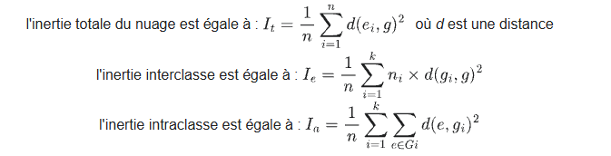
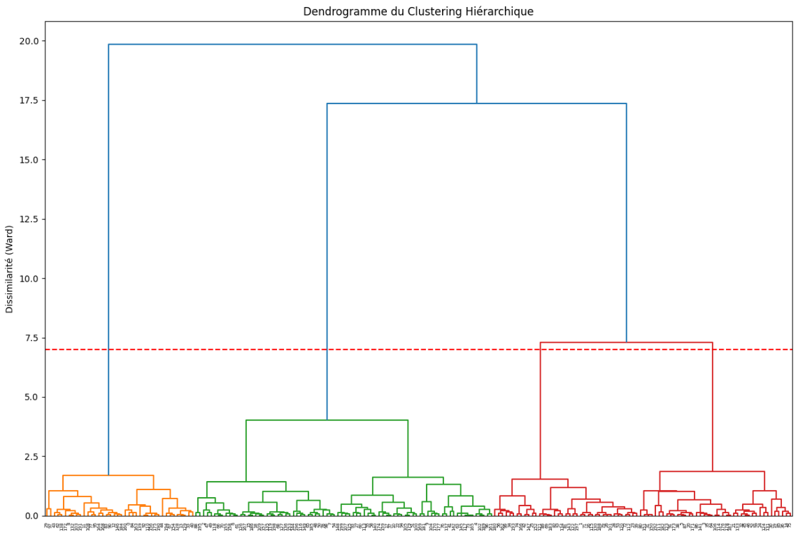
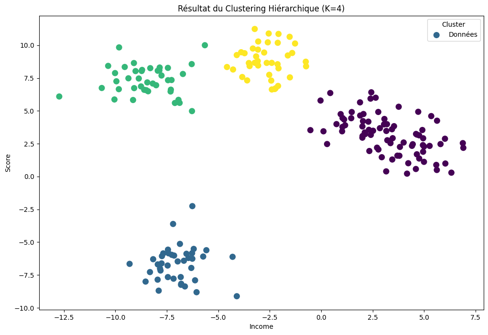

# Clustering hiérarchique agglomératif

Ce projet explore le clustering hiérarchique agglomératif pour regrouper des observations non étiquetées. Le notebook utilise les variables `Income` (revenu) et `Score` (score de dépense), standardise les données, puis applique la méthode de Ward pour construire les clusters.

## Données et méthode

Le notebook tente de charger le jeu de données [Mall Customers](https://raw.githubusercontent.com/uiuc-cse/data-fa14/gh-pages/data/mall_customers.csv). Si le fichier n'est pas accessible, il génère un jeu de données de remplacement avec `make_blobs`.

Les étapes principales sont :

1. Sélectionner les variables `Income` et `Score`.
2. Standardiser les données avec `StandardScaler`.
3. Construire un dendrogramme avec la méthode de Ward. La ligne horizontale rouge indique le seuil de dissimilarité choisi (7).
4. Appliquer le clustering agglomératif avec `K = 4` et calculer le score de silhouette.
5. Afficher les observations colorées selon leur cluster et sauvegarder le modèle ainsi que le scaler.

## Dendrogramme

Le dendrogramme illustre les fusions successives entre observations ou groupes. La hauteur d'une fusion représente leur dissimilarité selon Ward. La ligne rouge marque le seuil utilisé pour examiner la séparation des groupes.

### Interprétation mathématique de la dissimilarité de Ward

La méthode de Ward construit une partition en fusionnant, à chaque étape, les deux clusters qui dégradent le moins l'homogénéité des groupes. Pour formaliser ce critère, on distingue l'inertie totale, l'inertie entre les clusters et l'inertie à l'intérieur des clusters.

On note `n` le nombre total d'observations, `k` le nombre de clusters, `G_j` le cluster numéro `j`, `n_j` son effectif, `e_i` une observation, `g` le centre de toutes les observations et `g_j` le centre du cluster `G_j`. La fonction `d(a, b)` désigne la distance euclidienne entre deux points.

- **Inertie totale** : dispersion de toutes les observations autour du centre global.

  **I_t = (1 / n) × ∑_{i=1}^{n} d(e_i, g)²**

- **Inertie inter-clusters** : dispersion des centres des clusters autour du centre global, pondérée par leur effectif.

  **I_e = (1 / n) × ∑_{j=1}^{k} n_j × d(g_j, g)²**

- **Inertie intra-clusters** : dispersion des observations autour du centre de leur propre cluster.

  **I_a = (1 / n) × ∑_{j=1}^{k} ∑_{e ∈ G_j} d(e, g_j)²**



Ces quantités sont liées par le théorème de Huygens : **I_t = I_e + I_a**. Lors d'une fusion, l'inertie totale ne change pas. Réduire le moins possible l'inertie inter revient donc à augmenter le moins possible l'inertie intra. C'est ce que fait Ward.

### Déroulement de la méthode de Ward

1. **Initialisation** : chaque observation forme son propre cluster. L'inertie intra-clusters est alors nulle et l'inertie inter-clusters est égale à l'inertie totale.
2. **Évaluation des fusions** : pour chaque paire de clusters, calculer l'augmentation de l'inertie intra qui résulterait de leur fusion. Grâce à l'identité de Huygens, cela revient à choisir la fusion qui réduit le moins l'inertie inter-clusters.
3. **Fusion** : regrouper la paire dont le coût est le plus faible, puis recalculer le centre du nouveau cluster.
4. **Répétition** : poursuivre jusqu'à obtenir le nombre de clusters souhaité. L'ensemble des fusions successives forme le dendrogramme.

Pour deux clusters `A` et `B`, l'augmentation non normalisée de l'inertie intra lors de leur fusion s'écrit :

**ΔSSE(A, B) = (n_A × n_B) / (n_A + n_B) × d(g_A, g_B)²**

Ici, `n_A` et `n_B` sont les effectifs et `g_A` et `g_B` les centres des clusters. Ward choisit la paire dont `ΔSSE` est la plus petite.

Dans le dendrogramme calculé par SciPy avec `linkage(..., method="ward")`, la hauteur d'une fusion est :

**hauteur = √(2 × ΔSSE(A, B))**

Ainsi, une fusion à grande hauteur augmente davantage la dispersion intra-clusters. Le calcul du notebook s'effectue sur les variables `Income` et `Score` après standardisation.

Pour approfondir les notions d'inertie et le critère de Ward, voir l'article [Méthode de Ward](https://fr.wikipedia.org/wiki/M%C3%A9thode_de_Ward).



## Visualisation des clusters

Le graphique ci-dessous représente les observations selon leur revenu et leur score de dépense. Les couleurs indiquent les quatre clusters prédits par le modèle.



## Installation et exécution

Depuis le dossier du projet, installez les dépendances :

```bash
pip install -r requirements.txt
```

Ouvrez ensuite le notebook dans Jupyter :

```bash
jupyter notebook agglomerative.ipynb
```

Les artefacts du modèle et du scaler sont enregistrés dans le dossier courant sous les noms `agglomerative_clustering_model.pkl` et `scaler_agg.pkl`.
